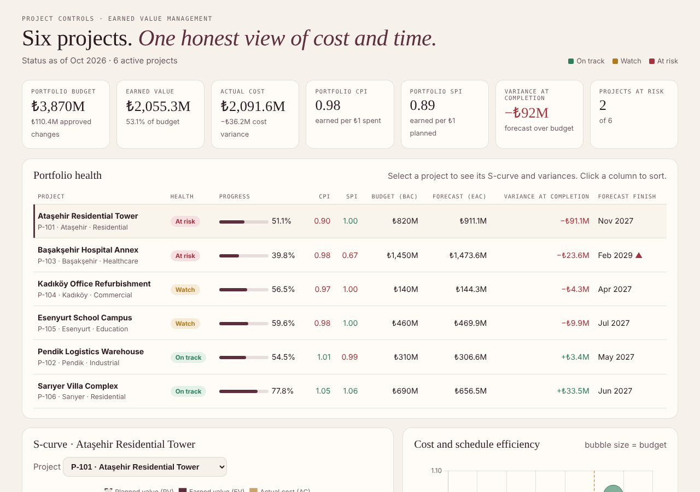
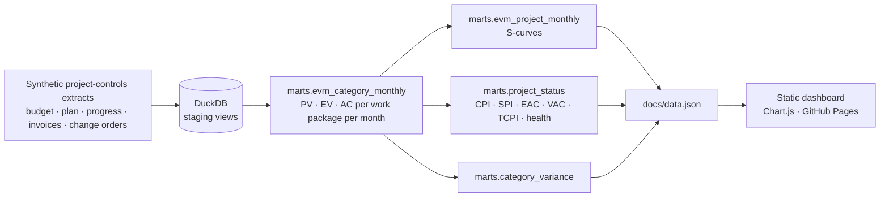

# Construction Cost Control · Earned Value Dashboard

An earned value management (EVM) model and interactive dashboard for **six construction projects of a fictional Istanbul contractor**: a residential tower, a hospital annex, a logistics warehouse, an office refurbishment, a school campus and a villa complex.

**[Open the live dashboard →](https://lidianarhoro88.github.io/construction-cost-control/)**



## The question

A monthly cost report says how much was spent. It does not say whether that spending bought the progress it should have. Earned value answers three questions for every project and every work package:

- **Are we on budget?** Cost performance index, `CPI = EV / AC`
- **Are we on schedule?** Schedule performance index, `SPI = EV / PV`
- **Where will we land?** Estimate at completion, `EAC = BAC / CPI`, and the efficiency the remaining work needs, `TCPI = (BAC − EV) / (BAC − AC)`

## What the dashboard shows (status October 2026)

| Project | Progress | CPI | SPI | Health | What is happening |
|---|---|---|---|---|---|
| Ataşehir Residential Tower | 51 % | **0.90** | 1.00 | At risk | Steel price escalation: the structural package costs about 21 % more than the work it has earned (CPI 0.83, −₺44 M). Forecast **₺91 M over budget**. |
| Başakşehir Hospital Annex | 40 % | 0.98 | **0.67** | At risk | Foundation and structure packages slipped; at this pace it finishes in Feb 2029 instead of Nov 2027. |
| Kadıköy Office Refurbishment | 57 % | 0.97 | 1.00 | Watch | Scope creep: 9 change orders, mostly MEP and finishes. |
| Esenyurt School Campus | 60 % | 0.98 | 1.00 | Watch | Small, spread-out overruns. |
| Pendik Logistics Warehouse | 55 % | 1.01 | 0.99 | On track | |
| Sarıyer Villa Complex | 78 % | 1.05 | 1.06 | On track | Under budget and ahead of plan. |

Portfolio: ₺3.87 B budget, CPI 0.98, SPI 0.89, forecast **₺92 M** over budget at completion, with two projects driving almost all of it.

The two at-risk projects fail in different ways, which is the point of tracking cost and schedule separately: the tower is a **cost** problem with time under control, the hospital is a **schedule** problem with cost under control.

## How it is built



| Input | Grain | Notes |
|---|---|---|
| `projects` | project | budget, start, planned finish |
| `budget_lines` | project × cost category | 7 WBS categories, sum to project budget |
| `planned_spend` | project × category × month | S-curve baseline (planned value) |
| `progress` | project × category × month | % complete from monthly site reports |
| `actual_costs` | invoice | 740 subcontractor, supplier and payroll invoices |
| `change_orders` | change order | approved, pending and rejected |

Earned value is computed **per work package** (`EV = % complete × category budget`) and only then rolled up. Rolling up % complete first would hide a late foundation package behind early site works.

## Tests

`pytest` checks the warehouse after every build, also in CI:

- earned value never exceeds budget;
- cumulative PV and AC never decrease month to month;
- actual cost in the marts reconciles to the invoice total;
- budget lines sum to the project budget, and the baseline reaches 100 % of budget at the planned finish;
- CPI, SPI and EAC match their definitions;
- health labels follow the stated rules (At risk: CPI < 0.95 or SPI < 0.90; Watch: CPI < 1 or SPI < 0.97).

## Run it

```bash
pip install -r requirements.txt
python scripts/generate_data.py     # data/raw/*.csv
python scripts/build.py             # warehouse.duckdb + docs/data.json
pytest -q
python -m http.server -d docs       # open http://localhost:8000
```

## Structure

```
scripts/generate_data.py   synthetic project-controls data with realistic problems
sql/01_staging.sql         typed views over the CSVs
sql/02_marts.sql           EVM model, project status, category variance
scripts/build.py           runs the SQL and exports dashboard data
docs/index.html            dashboard (light and dark), served by GitHub Pages
tests/                     data tests
```

All projects, vendors and figures are synthetic. The patterns (steel price escalation, slow foundation works, scope creep through change orders) are typical of building projects in Istanbul.
